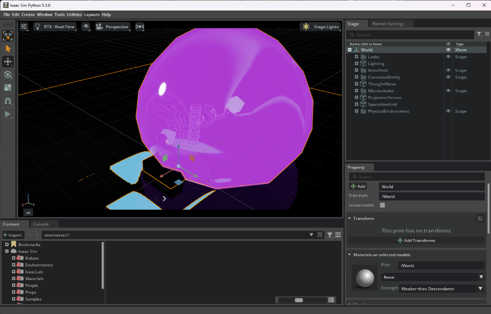
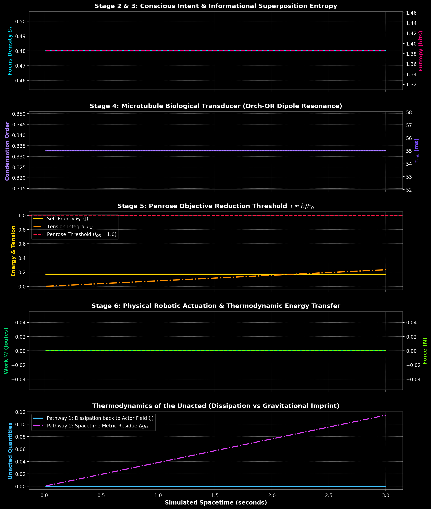

# The Actor Hypothesis Simulation Project
### NVIDIA Isaac Sim 5.0.1+ High-Fidelity Physics & Quantum Transduction Simulation

> **"From Thought to Reality: The transduction of conscious intent and the physics of cognitive wave-particle duality."**

---

## 1. Overview & Theoretical Foundation

This project implements a complete, mathematically rigorous, and visually immersive simulation of the **Actor Hypothesis** inside **NVIDIA Isaac Sim 5.0.1+ (Omniverse)**.

Traditional neuroscience treats unacted thoughts merely as biological noise or localized chemical byproducts within synaptic junctions. In contrast, the **Actor Hypothesis** proposes that **an unacted thought is a literal manifestation of Wave-Particle Duality in the realm of mind**:
* **The Unacted Thought (The Wave)**: Exists as *Dimensionless Non-Existence*—a pure uncollapsed quantum wave state $|\Psi\rangle$ residing in Hilbert space, possessing high informational entropy and zero physical 3D footprint.
* **The Executed Action (The Particle)**: A collapsed singular eigenstate localized in 4D spacetime, exhibiting low entropy determination, active mechanical force, and measurable mass/energy transfer.

---

## 2. The 6-Stage Transduction Chain

The simulation faithfully executes the complete 6-stage physical chain connecting conscious intent to classical robotic motor actuation:

```
[1. Actor Field] ──> [2. Conscious Entity] ──> [3. Thought Wave |Ψ⟩]
                                                        │
[6. Physical Action] <── [5. Actor Operator  & P̂] <── [4. Microtubules]
```

### Stage 1: The Actor Field ($\Psi_{\text{field}}$)
* **Ontology**: Non-local, universal background potential of awareness (analogous to the Higgs field generating mass).
* **Implementation**: Simulated as an ambient vacuum potential ($\rho_{\text{vac}} = 1.25 \times 10^{-9}\text{ J/m}^3$) with dynamic phase oscillations and an ethereal deep-purple visual aura (`/World/ActorField/AuraDome`).

### Stage 2: The Conscious Entity
* **Ontology**: A localized energy distortion or excitation strictly within infinite-dimensional Hilbert space.
* **Implementation**: Modulated by **Focus Density** $D_f \in [0.0, 1.0]$. High focus concentrates conscious intent into target choices, driving the system toward collapse.

### Stage 3: The Thought Wave ($|\Psi\rangle$)
* **Ontology**: Uncollapsed state vector in Hilbert space:
  $$\vert\Psi\rangle = \sum_{i=1}^N c_i \vert\phi_i\rangle, \quad \sum_{i=1}^N |c_i|^2 = 1$$
* **Probability Amplitude**: $c_i(t) = \sqrt{P_i(t)} e^{i(\omega_i t + \delta_i)}$
* **Entropy**: Informational Shannon/von Neumann entropy:
  $$S(\Psi) = -\sum_{i=1}^N |c_i|^2 \log_2(|c_i|^2)$$
* **Eigenstates**:
  1. $|\phi_0\rangle$: **Action Alpha** — Precision Reach & Grasp of Physical Cylinder
  2. $|\phi_1\rangle$: **Action Beta** — High Kinetic Push of Heavy Friction Block
  3. $|\phi_2\rangle$: **Action Gamma** — Fine Motor Actuation of Precision Switch
  4. $|\phi_3\rangle$: **Action Delta** — Sub-threshold Daydreaming Superposition

### Stage 4: Microtubules (The Biological Transducer)
* **Ontology**: Brain microtubules acting as biological antennas through orchestrated objective reduction ($Orch\text{-}OR$).
* **Implementation**: 13-protofilament cylindrical tubulin dipole lattice (260 tubulin heterodimers).
* **Quantum Vibrations**: Dipole polarization $p_j(t) = \tanh(\beta V_j) \cos(\omega_{\text{tub}} t + \phi_j)$.
* **Fröhlich Condensation**: Under elevated focus density, dipoles lock phase into collective coherence.
* **Coherence Time Scaling**: $\tau_{\text{coh}} = \tau_0 \cdot (1 + \alpha D_f)$.

### Stage 5: The Actor Operator ($\hat{A}$) & Projection Tensor ($\hat{P}$)
* **Gravitational Self-Energy ($E_G$)**:
  $$E_G = G \iint \frac{\Delta\rho(\mathbf{x})\Delta\rho(\mathbf{x}')}{|\mathbf{x} - \mathbf{x}'|} d^3x d^3x' \approx E_{G0} \cdot D_f^{2.2}$$
* **Objective Reduction Threshold**: Penrose condition:
  $$\tau \approx \frac{\hbar}{E_G}$$
* **Accumulated Tension Integral**:
  $$I_{OR}(t) = \int_0^t \frac{E_G(t')}{\hbar} dt'$$
  When $I_{OR} \ge 1.0$, spacetime geometry can no longer sustain the superposition, triggering collapse!
* **The Actor Operator ($\hat{A} \to a_k$)**: Forces the dimensionless wave into a singular eigenstate $|\phi_k\rangle$ with probability $|c_k|^2$.
* **The Projection Tensor ($\hat{P}$)**: Optical/shutter mechanism operating near Planck time that projects the collapsed Hilbert eigenstate into 3D Cartesian coordinates $\mathbf{x}_{\text{target}}$, orientation quaternions, and joint torque commands $\boldsymbol{\tau}$.

### Stage 6: Physical Action
* **Ontology**: Tangible 4D spacetime movement combating local entropic decay.
* **Implementation**: Articulated robotic manipulator in Isaac Sim PhysX moving toward the projected target, grasping/pushing objects, applying contact forces $F_{\text{contact}}$, and doing mechanical work:
  $$W = \int \mathbf{F} \cdot d\mathbf{x}, \quad \frac{dS_{\text{env}}}{dt} = -\frac{1}{T} \frac{dW}{dt} < 0$$

---

## 3. The OpenUSD Scenegraph Architecture & Simulation Viewport



The OpenUSD stage hierarchy (`/World`) is architected to mirror every stage of the Transduction Chain, providing direct visual feedback in real-time ray-traced rendering (RTX) inside NVIDIA Isaac Sim:

```text
/World (UsdGeomXform)
 ├── Looks (UsdGeomScope)
 │    ├── ActorFieldMat        : Translucent emissive purple dielectric aura
 │    ├── ConsciousEntityMat   : High-specular silver diamond crystal shader
 │    ├── ThoughtWaveMat       : Luminescent electric violet/cyan shader
 │    ├── TubulinAlphaMat      : Microtubule alpha-tubulin quantum dipole shader
 │    ├── TubulinBetaMat       : Microtubule beta-tubulin quantum dipole shader
 │    ├── ProjectionPrismMat   : Optical dielectric crystal prism
 │    ├── StarOperatorMat      : Gold/chrome Actor Operator polyhedral shader
 │    ├── SpacetimeGridMat     : Curvature metric wireframe & surface shader
 │    └── DarkTableMat / MetalRobotMat / TargetMats : PhysX material shaders
 ├── Lighting (UsdGeomScope)
 │    ├── KeyLight             : UsdLuxSphereLight (8000 lm, warm daylight)
 │    ├── FillLight            : UsdLuxSphereLight (3500 lm, cool cyan fill)
 │    └── CollapseFlash        : UsdLuxSphereLight (Dynamic 15000 lm flash on Objective Reduction)
 ├── ActorField (UsdGeomScope)           [Stage 1]
 │    └── AuraDome             : UsdGeomSphere (r = 2.8m, purple glowing translucent boundary)
 ├── ConsciousEntity (UsdGeomScope)      [Stage 2]
 │    └── DiamondCore          : UsdGeomCube (rotated 45 deg, localized Hilbert space excitation)
 ├── ThoughtWave (UsdGeomScope)          [Stage 3]
 │    └── WaveFilament         : UsdGeomPoints (Dynamic 45-point quantum wave packet |Psi>)
 ├── Microtubules (UsdGeomScope)         [Stage 4]
 │    └── Tubulin_0 .. 181     : UsdGeomSphere array (13 protofilaments x 14 rings dipole lattice)
 ├── ProjectionTensor (UsdGeomScope)     [Stage 5]
 │    ├── PrismLens            : UsdGeomCone (Refractive tensor shutter mechanism)
 │    └── StarOperator         : UsdGeomScope (Tri-blade star polyhedron executing A_hat -> a_k)
 ├── SpacetimeGrid (UsdGeomScope)
 │    └── CurvatureSurface     : UsdGeomMesh (Deformable 30x20 metric sheet showing gravitational residue)
 └── PhysicalEnvironment (UsdGeomScope)  [Stage 6]
      ├── GroundPlane          : UsdGeomCube (PhysX static collider floor)
      ├── WorkTable            : UsdGeomCube (PhysX static collider table)
      ├── RoboticManipulator   : UsdGeomXform (Base, articulated forearm, and physical gripper)
      ├── TargetCylinder_Alpha : UsdGeomCylinder (RigidBodyAPI, mass = 0.25 kg, Action Alpha target)
      ├── TargetBlock_Beta     : UsdGeomCube (RigidBodyAPI, mass = 0.85 kg, Action Beta target)
      └── TargetSwitch_Gamma   : UsdGeomCube (CollisionAPI, fine toggle switch, Action Gamma target)
```

### Detailed Scenegraph Component Breakdown:

1. **`/World/ActorField` (Stage 1: The Universal Substrate)**
   * **Visual Prim**: `AuraDome` (UsdGeomSphere, radius $2.8\text{ m}$, centered at `[-2.0, 0.0, 1.2]`).
   * **Physics/Quantum Role**: Represents the cosmic vacuum potential of awareness ($\rho_{\text{vac}} = 1.25 \times 10^{-9}\text{ J/m}^3$). It envelops the conscious entity in a glowing translucent purple aura, serving as the reservoir from which intent crystallizes and into which sub-threshold unacted thoughts gently dissipate (Pathway 1).

2. **`/World/ConsciousEntity` (Stage 2: The Hilbert Space Excitation)**
   * **Visual Prim**: `DiamondCore` (UsdGeomCube rotated $45^\circ$, centered at `[-2.5, 0.0, 1.2]`).
   * **Physics/Quantum Role**: Represents a localized excitation within infinite-dimensional Hilbert space. Its intentional density $D_f \in [0.0, 1.0]$ directs cognitive concentration toward specific potential physical action outcomes.

3. **`/World/ThoughtWave` (Stage 3: The Superposition Filament)**
   * **Visual Prim**: `WaveFilament` (UsdGeomPoints, dynamic 45-vertex ribbon/filament).
   * **Physics/Quantum Role**: Visualizes the uncollapsed state vector $|\Psi\rangle = \sum c_i |\phi_i\rangle$. The vertex coordinates dynamically undulate with complex phase velocities ($\omega_i t$), with packet amplitude governed by informational entropy $S(\Psi)$.

4. **`/World/Microtubules` (Stage 4: The Biological Transducer)**
   * **Visual Prim**: `Tubulin_0` to `Tubulin_181` (182 UsdGeomSpheres arranged in 13 protofilaments with helical pitch).
   * **Physics/Quantum Role**: Models the tubulin heterodimer lattice sustaining quantum vibrations ($Orch\text{-}OR$). Under deliberate focus, the dipoles synchronize into coherent Fröhlich condensation, coupling the dimensionless wave to local spacetime curvature. Under anesthesia, these dipoles decouple and freeze.

5. **`/World/ProjectionTensor` (Stage 5: Objective Reduction Shutter & Operator)**
   * **Visual Prims**: `PrismLens` (dielectric refractive cone) and `StarOperator` (tri-blade golden polyhedron).
   * **Physics/Quantum Role**: Calculates gravitational self-energy $E_G(t)$ against the Penrose threshold $\tau \approx \hbar / E_G$. When breached, `CollapseFlash` fires (15,000 lm flash), the Actor Operator collapses the superposition into a single physical eigenstate $|\phi_k\rangle$, and the Projection Tensor $\hat{P}$ maps it into 3D Cartesian target coordinates and joint torques.

6. **`/World/SpacetimeGrid` (The Metric Curvature Sheet)**
   * **Visual Prim**: `CurvatureSurface` (UsdGeomMesh with 600 vertices and 551 quad faces).
   * **Physics/Quantum Role**: Models the underlying spacetime metric tensor perturbations $h_{\mu\nu}$. Displays harmonic ripples during superposition, a sharp gravitational depression well during collapse, and accumulates persistent geometric warping in **Pathway 2: Spacetime Residue** ($\Delta g_{\mu\nu}^{\text{residue}} \ne 0$) when thoughts remain unacted.

7. **`/World/PhysicalEnvironment` (Stage 6: The Classical PhysX World)**
   * **Visual Prims**: Ground plane, work table, articulated robot manipulator, and interactive targets.
   * **Physics/Quantum Role**: Classical 4D spacetime domain governed by PhysX 5 dynamics. The robotic manipulator executes the collapsed motor command, applies contact force $F_{\text{contact}}$, performs mechanical work $W > 0$, and drives entropy reduction ($\Delta S_{\text{env}} < 0$).

---

## 4. Cognitive Wave-Particle Duality Matrix

| Attribute | Unacted Thought (The Wave) | Executed Action (The Particle) |
| :--- | :--- | :--- |
| **State** | Infinite probability superposition $\sum c_i \|\phi_i\rangle$ | Collapsed singular eigenstate $\|\phi_k\rangle$ |
| **Dimensionality** | Dimensionless (Hilbert Space) | Localized in 4D Spacetime |
| **Entropy** | High entropy potential ($S > 1.8$ bits) | Zero quantum entropy ($S = 0.0$ bits) |
| **Physicality** | Zero 3D physical footprint | Measurable physical mass/energy transfer ($W > 0$) |

---

## 5. Thermodynamics of the Unacted

What happens to thoughts that never cross the Objective Reduction threshold?



### Pathway 1: Dissipation
For low focus density thoughts ($D_f < 0.40$), the probability amplitude gently dissolves back into the universal Actor Field:
$$\langle \Psi_{\text{Actor}} \vert \Psi_{\text{Creator}} \rangle \ne 0, \quad |\Psi(t)\rangle \to e^{-\gamma_{\text{diss}} t} |\Psi_0\rangle$$

### Pathway 2: Spacetime Residue
Unacted thoughts leave a subtle, cumulative gravitational footprint in spacetime geometry without manifesting as physical action:
$$\Delta g_{\mu\nu}^{\text{residue}} = \int \kappa_{\text{res}} D_f(t) (1 - D_f(t)) dt$$
In the simulation, this appears as persistent curvature deformations in the 3D Spacetime Metric Grid (`/World/SpacetimeGrid`), as shown in the bottom panel of the telemetry analysis above.

---

## 6. Empirical Signatures & Falsifiability

1. **Testable Vector 1 (Quantum Biology)**:
   * Coherence time $\tau_{\text{coh}}$ measured during intense motor planning ($D_f = 0.95$) vs. passive distraction ($D_f = 0.18$).
2. **Testable Vector 2 (The Anesthesia Disruption)**:
   * General anesthetics physically disrupt hydrophobic quantum dipoles in tubulin proteins.
   * Disables the Actor Operator ($\hat{A}$), severing the transduction chain so that even high-focus intent fails to collapse into physical action.

---

## 7. Project Architecture

```
d:\1-Actor-Hypothesis-Simulation\
├── config\
│   └── simulation_config.json          # Master simulation parameters
├── docs\
│   └── images\
│       ├── simulation_viewport.png     # Isaac Sim 5.1.0 3D viewport screenshot
│       └── telemetry_analysis.png      # 5-panel scientific diagnostic plot
├── data\
│   ├── telemetry_log_residue.csv       # Tabular time-series metrics
│   └── telemetry_log_residue.json      # Structured simulation log
├── models\
│   └── usd\
│       └── actor_hypothesis_scene.usda # Clean exported OpenUSD stage
├── src\
│   ├── __init__.py                     # Package initialization
│   ├── quantum_engine.py               # Hilbert space state vector, amplitudes, entropy
│   ├── microtubule_transducer.py       # 13-protofilament Orch-OR lattice & anesthesia
│   ├── objective_reduction.py          # Penrose threshold tau ~ hbar/E_G, Â and P̂
│   ├── spacetime_geometry.py           # Metric perturbation h_munu & residual grid
│   ├── physical_actuator.py            # Robotic arm kinematics, PhysX contact, entropy
│   ├── usd_scene_generator.py          # Programmatic OpenUSD stage, shaders, and lighting
│   ├── telemetry_overlay.py            # ASCII real-time diagnostic dashboard & logger
│   └── simulation_engine.py            # Master simulation loop integrating all 6 stages
├── run_simulation.py                   # Main executable CLI
├── run_simulation.bat                  # One-click Windows launcher
├── run_simulation.ps1                  # Native PowerShell launcher
├── visualize_telemetry.py              # Scientific multi-panel plot generator
├── test_simulation.py                  # Automated headless test suite
├── The_Physics_of_Thought.pdf          # Theoretical foundation document
└── README.md                           # This documentation
```

---

## 8. How to Run the Simulation

### Option A: One-Click Windows / PowerShell Launcher
In PowerShell or Command Prompt, run either:
```powershell
.\run_simulation.ps1   # Native PowerShell (Recommended)
.\run_simulation.bat   # Windows Batch
```
This presents an interactive menu with continuous observation mode:
1. **Full Transduction Chain** (Thought Wave -> Collapse -> Robotic Action) [Runs Continuously]
2. **Pathway 1: Daydream Dissipation** (Return to Actor Field) [Runs Continuously]
3. **Pathway 2: Spacetime Residue** (Cumulative Gravitational Footprint) [Runs Continuously]
4. **Testable Vector 2: Anesthesia Disruption** (Severed Bridge) [Runs Continuously]
5. **Automated Verification Test Suite**
6. **Open Exported USDA Scene in Isaac Sim GUI Viewport** (Direct Inspection)
7. **Generate Scientific Telemetry Plots** (PNG multi-panel graphs)
8. **Custom Arguments / Duration Override**

> **Note on Continuous GUI Mode**: All visual scenarios run continuously until you close the Isaac Sim viewport window or press `Ctrl+C` in the terminal, giving you unlimited time to inspect the 3D scene, move cameras, and observe the physical and quantum phenomena!

### Option B: Isaac Sim Command-Line (CLI)

Using Isaac Sim's python wrapper (`D:\0-NVIDIA-Omniverse\isaac-sim\python.bat`):

#### 1. Full Transduction with GUI Visuals
```powershell
& "D:\0-NVIDIA-Omniverse\isaac-sim\python.bat" run_simulation.py --mode collapse
```

#### 2. Pathway 1: Daydream Dissipation
```powershell
& "D:\0-NVIDIA-Omniverse\isaac-sim\python.bat" run_simulation.py --mode daydream
```

#### 3. Pathway 2: Spacetime Residue
```powershell
& "D:\0-NVIDIA-Omniverse\isaac-sim\python.bat" run_simulation.py --mode residue
```

#### 4. Testable Vector 2: Anesthesia Disruption
```powershell
& "D:\0-NVIDIA-Omniverse\isaac-sim\python.bat" run_simulation.py --mode anesthesia
```

#### 5. Headless Benchmarking
```powershell
& "D:\0-NVIDIA-Omniverse\isaac-sim\python.bat" run_simulation.py --mode collapse --headless --duration 5.0
```

---

## 9. Automated Test Suite Verification

Run the automated test suite verifying all mathematical and physical invariants:
```powershell
& "D:\0-NVIDIA-Omniverse\isaac-sim\python.bat" test_simulation.py
```

### Verified Test Invariants:
* `[TEST 1] Full Transduction Chain`: $E_G$ breaches threshold at $\tau = 1.58\text{ s}$, $\hat{A}$ collapses superposition into singular eigenstate, $\hat{P}$ dispatches 3D target coordinates, robotic arm executes physical grasp doing $0.547\text{ J}$ of mechanical work.
* `[TEST 2] Pathway 1 (Daydream Dissipation)`: Low focus ($D_f = 0.18$) never crosses threshold; energy decays gracefully back to Actor Field ($E_{\text{diss}} > 0$).
* `[TEST 3] Pathway 2 (Spacetime Residue)`: Unacted superposition accumulates permanent metric distortion ($0.0763\text{ }d\_g_{00}$) on the spacetime grid.
* `[TEST 4] Testable Vector 2 (Anesthesia Disruption)`: Tubulin quantum oscillations frozen; Fröhlich condensation remains suppressed ($0.00$), halting the Actor Operator and preventing physical action despite maximum focus ($D_f = 0.95$).

---

## 10. Hardware & System Compatibility
* **Simulator**: NVIDIA Isaac Sim 5.0.1 / 5.1.0 (Omniverse Kit 107+)
* **GPU**: NVIDIA RTX (RTX 30/40/50 series, Ada Lovelace, Blackwell)
* **Python**: Python 3.11 (embedded within Isaac Sim)
* **Physics Backend**: PhysX 5.x GPU & CPU Dynamics
* **Scene Format**: Pixar OpenUSD (`.usda`, `.usd`)
